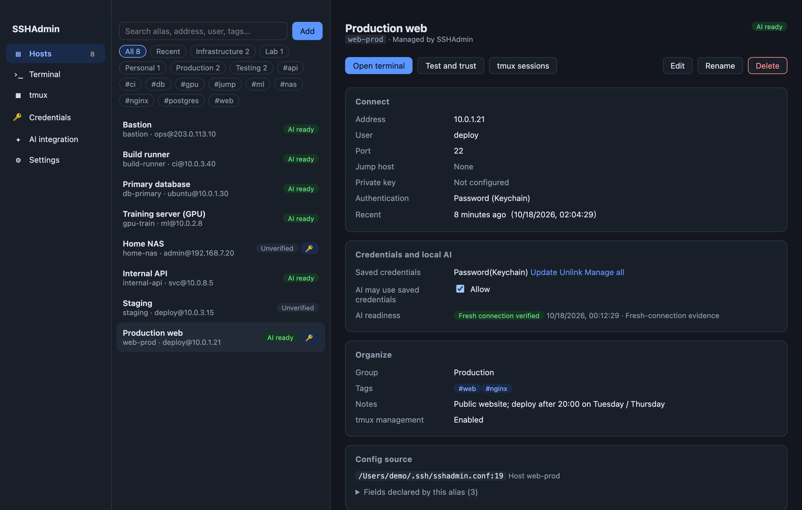

# SSHAdmin

[简体中文](README.md) · [English](README.en.md)

**Server management, with you in control.**

SSHAdmin brings hosts, keys, passwords, tabbed split terminals and remote tmux into one Apple Silicon Mac app. It uses system OpenSSH and your existing `~/.ssh/config`. Saved passwords stay in macOS Keychain; a local AI can use authorized connections through the CLI without receiving those saved passwords during authentication.

[Website](https://dfbtcice.github.io/sshadmin/en/) · [User guide](https://dfbtcice.github.io/sshadmin/en/manual.html) · [Report an issue](https://github.com/DFBTCice/sshadmin/issues)

> This repository contains the product website, user documentation and distributable builds. **The desktop application source remains private.** Website HTML, CSS and JavaScript are included here.



## Features

- Discover existing OpenSSH hosts; search, group, tag and annotate them. Preview configuration diffs with automatic backups before changes.
- Store passwords and private-key passphrases in macOS Keychain. Verify fingerprints and bind saved credentials to their destination.
- Work in local and SSH terminals with tabs, split panes, scrollback search and shortcuts.
- List, create, attach, rename and end remote tmux sessions. Closing a tmux terminal detaches the client.
- Connect a local AI with `sshadmin ssh <alias>`, or use `sshadmin exec` for structured JSON results.
- Operate locally, without an account, cloud sync or telemetry. Terminal screen history is off by default.
- Choose English, 简体中文 or Follow system. The preference persists and switching keeps existing terminals connected.

## Downloads and installation

Version **0.2.0** requires **macOS 12 or later on Apple Silicon (M series)**. The same application package includes both languages. Intel, Windows and Linux packages are not currently provided.

| File | Download |
| --- | --- |
| Mac installer (DMG, about 6.3 MiB) | [SSHAdmin-0.2.0-macos-arm64.dmg](docs/downloads/SSHAdmin-0.2.0-macos-arm64.dmg) |
| Mac archive (ZIP, about 5.6 MiB) | [SSHAdmin-0.2.0-macos-arm64.zip](docs/downloads/SSHAdmin-0.2.0-macos-arm64.zip) |
| Offline guides, Chinese and English | [ZIP](docs/downloads/SSHAdmin-0.2.0-guides.zip) |
| English narrated walkthrough (1080p) | [MP4](docs/video/sshadmin-demo-en.mp4) |
| Chinese narrated walkthrough (1080p) | [MP4](docs/video/sshadmin-demo-zh-CN.mp4) |
| SHA-256 checksums | [SHA256SUMS](docs/downloads/SHA256SUMS) |

The current version and earlier release assets are available in [GitHub Releases](https://github.com/DFBTCice/sshadmin/releases).

1. Download DMG or ZIP. When upgrading, save your work and fully quit the old version, then put `SSHAdmin.app` into `/Applications` and replace the old app.
2. The build is locally signed and **not notarized by Apple**. If macOS blocks the first launch, follow its prompt in **System Settings → Privacy & Security → Open Anyway**.
3. The app discovers existing configuration without automatically connecting or rewriting it.
4. Run **Test and trust** in host details and verify the server fingerprint before using saved credentials.

Compare the checksum of your selected file with the matching entry in SHA256SUMS:

```bash
shasum -a 256 SSHAdmin-0.2.0-macos-arm64.dmg
```

## Language

Choose Follow system, 简体中文 or English in **Settings → Appearance and terminal → Language**. The app remembers this preference across restarts. The website uses browser language on automatic entry and remembers a manual choice; explicit `/zh/` and `/en/` URLs keep their selected language. Both versions have a complete guide, localized screenshots, captions and narrated video. Host aliases, notes, configuration, JSON field names, error codes and remote output retain their original content.

For one CLI invocation, put `--lang en`, `--lang zh-CN` or `--lang system` **before** the subcommand. Arguments after the `ssh` subcommand belong to OpenSSH and pass through unchanged.

## Connect a local AI

Install the command link on **AI integration**, then copy that page's instructions to an AI that can execute commands on your Mac. Automatic saved-password use requires host authorization, verified binding and available Keychain access.

```bash
sshadmin --lang en list --json
sshadmin ssh dev-server 'hostname; df -h'
sshadmin exec dev-server --command 'uname -a' --json --timeout 30
```

Replace `dev-server` with your exact managed alias. The CLI can run while the GUI is closed. The launcher adds no execution timeout or output limit; other tools and networks may impose their own restrictions. See the [guide](https://dfbtcice.github.io/sshadmin/en/manual.html#ai) for authentication boundaries and uncertain results.

## Scope and feedback

There is no built-in SFTP browser, cloud synchronization, multi-user permissions, MCP server or automatic remote software installation. tmux must already exist on the server. Ordinary SSH alone does not guarantee that tasks survive disconnection.

[Open an issue](https://github.com/DFBTCice/sshadmin/issues) with your app/macOS versions, reproduction steps and error details. Remove passwords, private keys, real server addresses and other sensitive information before posting.
