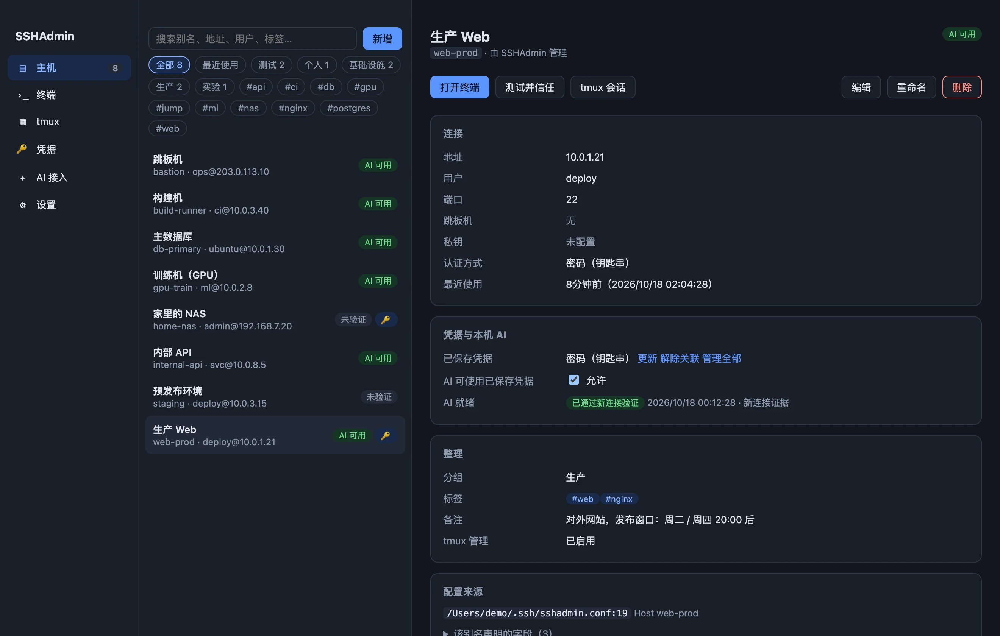

# SSHAdmin

[简体中文](README.md) · [English](README.en.md)

**管服务器，人和 AI 都放心。**

SSHAdmin 是面向 Apple Silicon Mac 的 SSH 管理工具，把主机、密钥、密码、多标签分屏终端和 tmux 收进一个桌面应用。沿用系统 OpenSSH 和已有的 `~/.ssh/config`，密码保存在 macOS 钥匙串；本机 AI 可以通过命令行使用已授权的连接。

[访问官网](https://dfbtcice.github.io/sshadmin/) · [下载与安装](#下载与安装) · [使用手册](https://dfbtcice.github.io/sshadmin/zh/manual.html) · [反馈问题](https://github.com/DFBTCice/sshadmin/issues)

> 本仓库用于产品展示、使用文档和成品发布。**桌面应用源码暂不公开。** 仓库中的 HTML、CSS 和 JavaScript 用于产品官网。



## 主要功能

- **主机管理**：识别现有 OpenSSH 配置，支持搜索、分组、标签和备注；修改前预览差异并自动备份。
- **密码与密钥**：密码和私钥口令保存在 macOS 钥匙串；连接前核对服务器指纹，凭据与登录目标绑定。
- **多标签分屏终端**：本地 Shell 和远程 SSH 集中操作，支持回滚搜索和常用快捷键。
- **tmux 会话**：查看、新建、接入、重命名和结束远端会话；关闭终端标签只分离会话。
- **本机 AI 接入**：用 `sshadmin ssh <别名>` 登录，或用 `sshadmin exec` 获取结构化 JSON 结果，由应用代为提交已授权的凭据。
- **本地使用**：无账号、无云同步、无遥测；终端历史默认关闭，可以自行开启或清除。

## 下载与安装

当前版本 **0.2.0**，适用于 **Apple Silicon（M 系列）Mac**，要求 **macOS 12 及以上**。一个安装包包含中英文，可在设置中选择跟随系统、简体中文或 English；切换不会断开正在使用的终端。

| 文件 | 下载 |
| --- | --- |
| Mac 安装包（DMG，约 6.3 MiB） | [SSHAdmin-0.2.0-macos-arm64.dmg](docs/downloads/SSHAdmin-0.2.0-macos-arm64.dmg) |
| Mac 压缩包（ZIP，约 5.6 MiB） | [SSHAdmin-0.2.0-macos-arm64.zip](docs/downloads/SSHAdmin-0.2.0-macos-arm64.zip) |
| 双语离线手册 | [下载 ZIP](docs/downloads/SSHAdmin-0.2.0-guides.zip) · [中文在线手册](https://dfbtcice.github.io/sshadmin/zh/manual.html) · [English guide](https://dfbtcice.github.io/sshadmin/en/manual.html) |
| 中文配音演示（1080p） | [下载 MP4](docs/video/sshadmin-demo-zh-CN.mp4) |
| 英文配音演示（1080p） | [Download MP4](docs/video/sshadmin-demo-en.mp4) |
| SHA-256 校验值 | [SHA256SUMS](docs/downloads/SHA256SUMS) |

此前版本与附件仍可从 [GitHub Releases](https://github.com/DFBTCice/sshadmin/releases) 获取。此分支的 0.2.0 内容待审阅后才合并并更新线上。

1. 下载 DMG 或 ZIP，把 `SSHAdmin.app` 放入 `/Applications`。
2. 当前版本为**本地签名、未经 Apple 公证**。首次打开如果被系统拦截，请按 macOS 提示到「系统设置 → 隐私与安全性」选择“仍要打开”。
3. 启动后会识别已有 SSH 配置。首次识别不会自动连接服务器或改写配置。
4. 在主机详情中完成“测试并信任”，核对服务器指纹后再使用保存的凭据。

下载 `SHA256SUMS` 后，可在安装包所在目录核对所选文件，例如：

```bash
shasum -a 256 SSHAdmin-0.2.0-macos-arm64.dmg
```

将输出与 `SHA256SUMS` 中同名文件的记录比较。

## 语言与官网

应用语言会跨重启保存。官网按浏览器语言自动进入，也可以手动选择中英文并记住选择。介绍、完整手册、界面截图、字幕和配音视频均有对应版本。主机别名、备注、SSH 配置与远端命令输出保留原文。CLI 可在子命令前添加 `--lang en` 或 `--lang zh-CN`，JSON 字段和错误码保持稳定。

## 让本机 AI 使用

在应用的「AI 接入」页安装 `sshadmin` 命令链接，将页面中的说明复制给本机 AI。只有允许 AI 使用凭据且已通过连接验证的主机，才能自动使用已保存的密码。

```bash
sshadmin list
sshadmin ssh dev-server 'hostname; df -h'
sshadmin exec dev-server --command 'uname -a' --json --timeout 30
```

`dev-server` 是示例别名，请替换为自己的主机名。CLI 可以独立于 GUI 运行。更多命令和安全边界见[使用手册](https://dfbtcice.github.io/sshadmin/zh/manual.html#ai)。

## 当前边界与反馈

当前版本不包含 SFTP 文件管理器、云同步、多人权限、MCP 服务或自动安装远端软件。tmux 功能要求服务器已有 tmux；普通 SSH 终端中的任务不保证在断开后继续运行。

遇到问题请[提交 Issue](https://github.com/DFBTCice/sshadmin/issues)，附上应用版本、macOS 版本、复现步骤和错误信息。提交前请去除密码、私钥、真实服务器地址及其他敏感信息。
